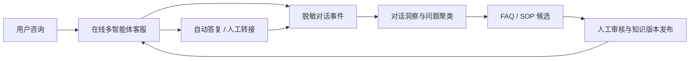
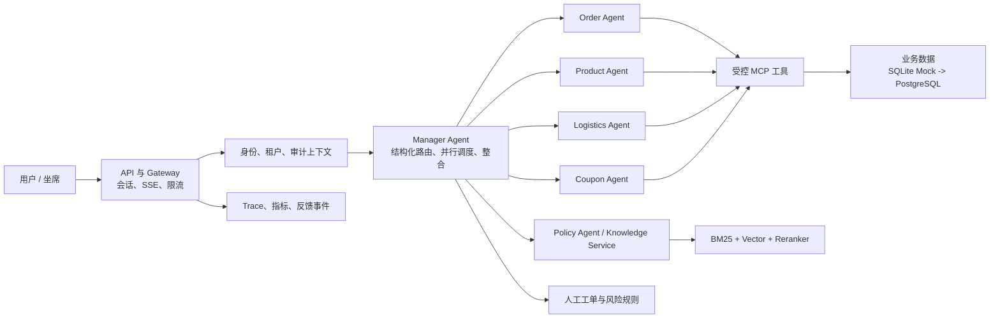

# 企业级设计基线

> 项目定位：面向电商客服场景的多智能体客服中台验证项目。


## 1. 业务问题与项目目标

电商客服同时面临用户表达模糊、FAQ 覆盖不足、多轮上下文丢失、负面情绪升级和人工坐席无法及时发现重复问题等情况。本项目把系统拆为两条互相闭环的链路：



- 在线链路解决单次咨询：准确、可控地完成查询、答复、转人工和高风险操作引导。
- 离线洞察链路解决系统改进：从对话日志发现未解决问题、重复咨询和情绪升级，形成可审核的知识库更新建议。
- 目标是提高可自动解决的问题比例、降低不必要人工介入、缩短负面问题响应时间；任何具体指标必须由实际评测或压测产物支持。

## 2. 当前基础与目标状态

| 能力 | 当前已实现 | 设计目标 |
| --- | --- | --- |
| 多智能体 | Gateway、Manager、订单/商品/物流/优惠券 Agent | 保留领域 Agent，按领域隔离工具和提示词 |
| 业务工具 | MCP + SQLite Mock 数据 | 工具调用审计化，业务数据可替换为服务接口 |
| 知识问答 | BM25 + FAISS + Reranker | 来源引用、文档版本、低置信度拒答、人工发布 |
| 对话体验 | Redis Checkpoint、SSE、缓存、超时降级 | 绑定身份、限流、依赖就绪检查 |
| 人机协同 | 规则情绪检测、人工工单状态流转 | 优先级队列、客服权限、处理时限指标 |
| 质量运营 | Prompt 版本、Langfuse、评测和压测脚本 | 对话日志洞察、FAQ 候选、审核发布和回归评测 |

## 3. 在线服务架构



### 3.1 保留的智能体

| 模块 | 职责 | 明确禁止 |
| --- | --- | --- |
| Gateway | 会话恢复、上下文摘要、流式输出、调用 Manager | 不直接判断业务；不开放本地文件读写 |
| Manager | 意图识别、任务拆分、并行调度、结果整合、转人工判断 | 不直接访问数据库；不直接执行高风险写操作 |
| Order | 订单查询、售后资格判断、生成退款/取消草案 | 不绕过工具返回编造订单事实 |
| Product | 商品检索、推荐、库存和价格说明 | 不修改商品或库存 |
| Logistics | 物流轨迹、异常判断、预计送达 | 不改变物流状态 |
| Coupon | 优惠券、活动、优惠建议 | 不直接发券或核销 |
| Policy | 政策/SOP 检索、引用和置信度判断 | 不以无来源内容回答规则问题 |

当前 `manager_agent.py` 中的 `get_policy` 可以作为 Policy 能力的第一阶段实现；知识库权限、版本与评测能力增加后，再抽取为独立服务。

### 3.2 标准请求链路

1. API 层验证请求体，解析登录态，服务端生成可信的租户、用户和角色上下文。
2. Gateway 恢复会话，检查限流、公共 FAQ 缓存和未完成操作。
3. Manager 以结构化结果输出领域路由、并行任务、RAG 需求和风险等级。
4. 领域 Agent 仅调用白名单 MCP 工具；工具服务再次进行租户和数据权限校验。
5. Manager 汇总工具事实与知识引用，回复用户、追问缺失信息或创建人工工单。
6. 过程事件进入 Trace 与日志洞察链路，用于后续评测和知识运营。

## 4. 受控工具与人工协同

读操作可自动执行；退款、补偿、改地址等写操作统一走审批工作流：

```text
用户请求退款
-> Order Agent 查询订单和资格
-> 返回操作草案（订单、金额、规则引用）
-> 用户确认或人工审批
-> 带 idempotency_key 的工具执行
-> 写入审计日志和状态变更
-> 返回结果或继续转人工
```

转人工优先级由“用户主动要求、负面情绪、连续失败、低置信度、交易风险”共同决定。当前规则情绪检测用于快速拦截；后续可使用 LLM 结构化判定补充复杂语义，但不能让情绪模型单独决定资金类动作。

## 5. 对话洞察与知识运营闭环

这是本项目区别于普通聊天机器人的核心增量。它不是把原始对话直接交给模型训练，而是把日志转化为可审核的运营信号。

### 5.1 事件模型与预处理

在线服务以事件方式记录 `conversation_id`、轮次、路由、工具结果摘要、是否解决、转人工原因、用户反馈、延迟和 Prompt/知识版本。进入洞察库前执行：

- PII 脱敏：手机号、地址、订单号只保留掩码或哈希；原文不进入分析样本。
- 规范化：去除 HTML、无业务意义的表情与重复空白，统一时间、渠道与错误码。
- 会话切分：按 `conversation_id` 和超时窗口聚合多轮对话，保留摘要、意图和最终结果。
- 数据质量：标记缺失字段、工具异常和重复事件，避免直接污染评测与知识库。

### 5.2 意图、上下文与情绪方法

| 目标 | 推荐方法 | 选择依据 |
| --- | --- | --- |
| 高频简单意图 | 关键词/正则规则 | 快、可解释、零额外模型成本 |
| 复杂或多意图 | LLM 结构化输出为固定标签与置信度 | 与现有 Agent 栈一致，无需自建标注语料 |
| 多轮上下文 | LangGraph Checkpoint + 会话摘要 + 关键槽位 | 直接服务在线流程，优于为本项目引入 RNN/LSTM |
| 情绪与升级 | 规则初筛 + LLM 复核 + 业务优先级 | 可解释且可防止单一模型误判 |
| 相似问题聚类 | Embedding 向量 + 聚类 + 人工命名 | 用于发现 FAQ 缺口和重复问题 |


### 5.3 FAQ 候选生成与发布

```text
未解决 / 重复 / 低满意度对话
-> 按意图和向量聚类形成问题簇
-> LLM 生成 FAQ 候选（问题、建议答复、来源、风险标签）
-> 运营或法务人工审核
-> 写入带版本的知识库
-> 离线回归评测
-> 灰度发布至 Policy Agent
-> 观察命中率、转人工率、满意度
```

LLM 只能生成候选，不能自动发布售后、退款和合规规则。每个发布版本必须可回滚，并记录来源、审核人和生效时间。

### 5.4 分析看板

最小可展示看板包括：Top 问题簇、未解决率、转人工率及原因、负面情绪队列、工具失败率、RAG 无引用率、答复耗时、满意度趋势和 FAQ 发布前后对比。第一阶段使用 SQLite/PostgreSQL 聚合任务即可；消息队列和流式计算属于后续扩展，不必为了包装强行引入。

## 6. RAG 可信回答

知识库包含平台规则、售后协议、客服 SOP 和 FAQ。切片元数据至少包括 `document_id`、来源、版本、有效期、适用角色和租户范围。

检索流程：查询改写（可选） -> BM25 与向量召回 -> 去重 -> Reranker -> 置信度判定 -> 带来源的回答。检索不足时明确拒答、请求补充信息或转人工。

当前生产默认使用 Milvus 作为版本化共享向量索引，保留 BM25 + Reranker 检索链路；FAISS 仅可通过显式配置作为本地开发回退，不能再表述为生产主检索实现。

## 7. 安全、可观测和质量闭环

- 身份从 JWT/会话服务解析，禁止以 URL 的 `user_id` 作为可信身份来源。
- MCP 服务端二次鉴权；订单、工单、缓存和知识库均按 `tenant_id` 隔离。
- Gateway 移除 `FilesystemMiddleware`；文件需求改为对象存储白名单和短期授权。
- 缓存仅保存稳定、公共、无个人信息的答案；缓存键包含租户、权限和知识版本。
- Trace 和日志对订单号、手机号、地址脱敏；保存请求 ID、路由、工具结果摘要、版本、耗时、Token、转人工原因和反馈。
- 离线评测覆盖订单、商品、物流、政策、多意图、拒答、越权、提示词注入及工具失败；每次 Prompt 或知识版本变更必须回归。

## 8. 分阶段交付与验收

| 阶段 | 交付内容 | 验收标准 |
| --- | --- | --- |
| 第一阶段：安全边界 | 请求模型、JWT/RBAC、租户上下文、删除文件系统工具 | 篡改 URL 不能读取其他用户会话或订单 |
| 第二阶段：受控服务 | 结构化路由、工具白名单、操作草案/确认/幂等、人工工单 | 高风险请求未经确认不改变业务数据 |
| 第三阶段：知识运营 | 脱敏事件、问题聚类、FAQ 候选、审核发布、引用回答 | 新 FAQ 只能经审核、可回滚并通过回归评测 |
| 第四阶段：质量运营 | 看板、Trace 脱敏、反馈回流、压测与测试报告 | 可定位一次失败会话并追溯到版本和评测样本 |

## 9. 面试叙事与真实边界

项目的核心取舍是：LLM 负责理解、路由、整合和生成候选；业务事实来自受控工具，规则来自可引用知识库，高风险动作交由工作流审批。在线多 Agent 服务解决当下咨询，离线对话洞察持续发现问题并驱动知识更新，最终通过评测和看板证明迭代效果。


